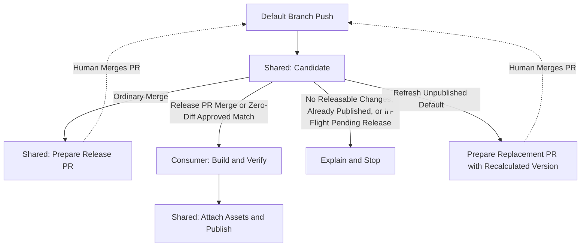

# Rust Release Candidate

Use three reusable workflows to maintain one release PR and publish its approved version after consumer builds succeed.
The [complete example](example.yaml) publishes an explicitly asset-free release.
Insert consumer build jobs and declare their required artifacts to publish binaries or archives.

## Consumer Contract

- The repository uses direct devenv or a flake-integrated devShell at its root.
- Native Rust 1.88 or newer, Cargo, Convco, Git, GitHub CLI and `sha256sum` are available inside that environment.
- Root Cargo.toml owns either `package.version` for a single package or `workspace.package.version` for a workspace.
  Workspace packages inherit `version.workspace = true` and share that one version.
- Cargo.lock is committed.
  Internal path dependency version requirements and workspace lock entries are derived during preparation.
- This initial workflow supports stable SemVer releases with `v<version>` tags.
  It does not move major aliases, publish crates, build applications or publish images.
- Required PR checks and up-to-date branch protection are configured by the consumer.
  Only merge the generated release PR after its refreshed checks pass.
  Do not add commits or use GitHub's Update Branch button on `release/next`; let prepare regenerate it.
- Give the caller one non-cancelling concurrency group with `queue: max`, as shown in the example.
  All release stages belong to that caller; the shared workflows do not reacquire its lock.

The workflow discovers the default branch through GitHub; `main`, `master` and `trunk` are supported.
Set the caller's push filter to that branch.
Release-branch pushes and PR events do not trigger the release pipeline.
The context is checked before entering consumer devenv or using write credentials.

## Inputs and Outputs

- `commit-sha` is required and must match the triggering push's full SHA.
- `job-name` sets the candidate job display name and defaults to `Identify Rust Release Candidate`.
- `runs-on`: optional JSON runner label, label array or group/labels object; empty follows the [organisation runner policy](../../docs/setup.md#runner-selection).
- `type` defaults to `devenv`; use `flakes` with `flake-shell`, which defaults to `.#default`.
- `devenv-installable` optionally pins the native devenv CLI.
- `pending-release-policy` defaults to `refresh-unpublished`; `wait` blocks newer default-branch commits until an earlier pending release finishes or is manually replaced.
- `recover-pending` defaults to `false`; `true` selects the pending approved source on a manual default-branch run.

The job requires Contents, Pull Requests and Actions read permissions.
No App credentials are needed for candidate inspection.

- `prepare-ready` is `true` for an ordinary current default-branch commit eligible to refresh the release PR.
- `release-ready` is `true` for a validated merge of the managed release PR, or for a zero-diff commit whose release files already match Convco's output for an already-approved unpublished version.
- `version`, `tag`, `commit-sha` and `pr-number` identify the approved release candidate.
- Both ready outputs are `false` for non-releasable commits, obsolete work, an already-published release, or an ordinary merge waiting for an earlier in-flight or tagged release to finish.
- `reason` explains those no-op decisions.
- `decision` identifies the outcome without parsing prose.
- `pending-commit-sha`, `pending-version` and `pending-run-url` identify work awaiting publication or replacement.
  The run URL is empty when the original push run is unavailable.
- `recovery` is `true` when the selected approved source requires recovery publication.

Candidate decisions are:

- `prepare`: refresh the normal release PR.
- `refresh-unpublished`: prepare a replacement PR with the Convco-recalculated version for fresh approval.
- `release`: build and verify the approved source before publication.
- `skipped`: no releasable changes exist since the previous tag, so no preparation job is needed.
- `pending-release`: wait for or recover the earlier release.
- `published`: the selected release is already published.
- `superseded`: a newer managed release replaced this candidate.
- `obsolete`: a newer default-branch run owns preparation.
- `no-pending-release`: manual pending recovery has nothing to retry.

Waiting, skipped and obsolete work are successful no-ops.
Do not turn `pending-release` or `skipped` into a failure or match strings in `reason`.
The shared action writes the decision explanation, pending version, source and original run link to its job summary.
Build, verification and publication failures still fail their jobs.

The candidate verifies the managed PR's repository, branch, marker, reviewed tree, base commit, derived version files and changelog heading.
Additional trunk commits after a correct release merge do not change the source commit to publish.
A release PR merged from a stale base is never published; under the default `refresh-unpublished` policy, candidate automatically selects `refresh-unpublished` so preparation rebuilds a fresh release PR from current source, while `wait` fails the run.

Use `needs.candidate.outputs.release-ready == 'true'` to enable project build jobs.
Make publication depend on every required build, and keep the normal success condition.
Do not put `prepare` in publication's `needs`, because prepare is skipped during release publication.

Pin all three calls to the same reviewed release SHA containing these workflows.
The shared workflows compose their bundled actions at that same revision.
Dependabot can then update the workflow pins together.

See [preparation](../rust-release-prepare/README.md) and [publication](../rust-release-publish/README.md).

## Common Project Setup

See [shared setup and runner selection](../../docs/setup.md) for LFS checkout, SecretSpec profiles and optional read-only dependency App authentication.

Runner defaults follow the [organisation runner policy](../../docs/setup.md#runner-selection).
`runner-architecture` accepts `AMD64` (default) or `ARM64`; ARM64 selects `aarch64-linux` unless `system` explicitly overrides it.
Explicit `runs-on` selectors take precedence over organisation defaults.

## Manual recovery with corrected orchestration

The [complete example](example.yaml) includes a `recover-pending` dispatch checkbox.
Select the default branch and enable it to retry the pending release without looking up its commit SHA.
Candidate receives the triggering `${{ github.sha }}` as `commit-sha`, uses the current environment to select the pending release, then checks out and verifies the approved source.
It returns that source as `commit-sha` and sets `recovery` to `true`.
Use the returned SHA for every build and verification job and set publication's `recovery` from candidate's output.
No pending release produces a successful no-op with both ready outputs false.
Automatic events and combining `recover-pending` with `recovery` or `replace-unpublished` are rejected.

Explicit source selection remains supported.
Set `recovery: true` only for a `workflow_dispatch` from the default branch.
Pass the full merged managed release commit SHA as `commit-sha`.
The source checkout must match that approved commit, while `github.sha` identifies the newer workflow revision.
The approved source must be an ancestor of the workflow revision and remain the pending release.
Unapproved commits and automatic recovery events are rejected.
An already published release remains an idempotent no-op.

All build, CI, security and acceptance jobs must check out the candidate's `commit-sha` output.
Keep orchestration helpers at the triggering workflow revision if the older source predates their fixes.
Use the optional `source-ref` input on the shared CodeQL and Trivy workflows to analyse the approved source.
Call publish with the same `recovery: true` and approved SHA after every required gate passes.
A recovery run may publish only its own artifacts, whose manifest must name the approved source, never the newer workflow commit.
Recovery does not prepare another release PR or permit replacing an immutable version tag.

The normal path retains the exact-trigger-commit requirement when `recovery` is false.

## Replacing an unpublished source

`pending-release-policy` defaults to `refresh-unpublished` on both candidate and prepare so newer fixes on the default branch self-heal an unpublished release automatically.
Set `pending-release-policy: wait` on both candidate and prepare to opt into strict waiting instead.
The [complete example](example.yaml) enables automatic refresh and manual pending recovery.

When the pending release's original push workflow is still queued or running, candidate returns `pending-release` so the in-flight build can finish.
Once that run is no longer active and the pending release has no version tag, published release, prerelease or unrelated draft, candidate checks the recalculated Convco version from the previous tag.
If Cargo.toml, Cargo.lock and CHANGELOG.md already match Convco's exact output for the already-approved unpublished version, candidate selects the current commit directly (`release-ready=true`) so builds and publication proceed without opening a duplicate PR.
Otherwise, preparation opens or refreshes `release/next` from current source using Convco's recalculated version, even if Cargo has moved ahead or a newer feature raises a patch to a minor release.
Identical retries preserve the PR head; subsequent default-branch merges refresh the same PR.
Publication still requires a fresh human merge and every consumer build and verification gate whenever a replacement PR is prepared.
The previous candidate becomes superseded once the replacement merges or publishes.
Preparation rechecks draft visibility with its write credential before changing the release branch, so a draft targeting an unrelated commit still prevents replacement.
Orphaned untagged drafts targeting the superseded pending commit do not block replacement and are deleted and recreated cleanly at publication.
Tagged releases, published releases, prereleases and unrelated drafts return a pending decision and must be recovered from their original source.

Keep every release stage in one non-cancelling caller concurrency group with `queue: max`, including recovery and replacement runs.
Finish any historical publication runs using older tooling before approving a replacement.
The updated publisher rejects superseded sources and rechecks eligibility after downloading artifacts.

For explicit manual replacement, the existing SHA input remains supported.
When an application correction needs new source, set `replace-unpublished` to the full pending managed release SHA on both candidate and prepare.
Dispatch from the current default branch, use its exact `${{ github.sha }}` as `commit-sha`, and leave `recovery` false.
The selected release must have no version tag, published release, prerelease or unrelated draft.

Preparation opens or refreshes `release/next` from the corrected source using Convco's recalculated version, even if Cargo has already moved ahead.
The PR records the source it replaces and needs a fresh human merge after its checks pass.
If the default branch advances before that merge, dispatch preparation again with the same pending SHA or rely on the default `refresh-unpublished` policy.
With `pending-release-policy: wait`, ordinary preparation remains blocked until a replacement is approved and published.

After approval, build and publish the new merged SHA through the normal release gates.
The updated release tool rejects the previous candidate and rechecks eligibility after downloading artifacts.
Keep all caller release operations in one non-cancelling concurrency group and finish older publication runs before approving replacement.
Retry through the updated default-branch workflow; historical runs pinned to older release tooling do not gain these new guards.

After publication, omit `replace-unpublished` and resume ordinary managed releases.

## Debug Logging

Pass `debug: true` under the calling job's `with:` to enable verbose tool logs and phase diagnostics.
GitHub's **Re-run with debug logging** enables the same behaviour automatically.
See [the debug contract](../../README.md#debug-logging) for details.
